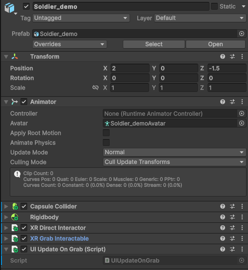
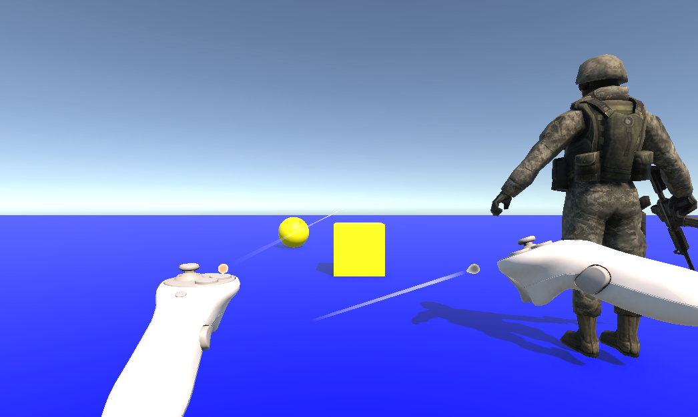

# XR interaction toolkit

This report details the implementation of an academic Virtual Reality (VR) 
exercise developed in Unity using the Universal Render Pipeline (URP), OpenXR, 
and the XR Interaction Toolkit (XRI). The primary goal is to establish a 
functional VR environment, featuring three interactable objects and a fully 
configured `XR Origin` setup with integrated locomotion and interaction 
providers.

## System Architecture and Component Configuration

### Scene Hierarchy Overview

The scene architecture separates the spatial rig, interaction managers, 
environment, and user interface.

*Figure 1: Final Scene Hierarchy showing Plane, Cube, Sphere, Soldier from the 
Asset Store, UI Canvas, Event system, XR Interaction Manager and XR Origin*

### XR Origin & Locomotion Setup

The generic camera was replaced by the `XR Origin (VR)` prefab. To support 
navigation and orientation, two core locomotion components were attached 
directly to the `XR Origin` GameObject:
- **Locomotion Mediator:** Acts as the central registry coordinating movement requests across providers.
- **Teleportation Provider:** Handles ray-based locomotion for instantaneous spatial transition.

### Interactable Entities Setup

1. **Ray Interactables (Cube & Sphere):**
   - Configured with `Rigidbody` and Colliders.
   - Attached to custom script `ColorChangeOnSelect.cs`, listening to `selectEntered` events triggered by the `XR Ray Interactor`.

2. **Direct Interactable (Asset Store Object):**
   - Configured with a `Rigidbody` and Colliders.
   - Attached to `UIUpdateOnGrab.cs` to trigger text updates on selection.

*Figure 2: Inspector configuration of the Asset Store object featuring 
Colliders, Rigidbody, XR Direct Interactable, XR Grab Interactable, and 
UIUpdateOnGrab components.*

## Scripts

### System Requirements

The specifications required creating an interactive VR scene supporting both 
Ray and Direct Interactors, object state modification on selection, and dynamic 
UI updates upon interaction. The behavior was modularized into two C# scripts: 
`ColorChangeOnSelect.cs` and `UIUpdateOnGrab.cs`.

### ColorChangeOnSelect.cs

`ColorChangeOnSelect.cs` manages dynamic material color changes on Ray 
Interactor targeting. In `Awake`, it caches references to its 
`XRGrabInteractable` and `Renderer` components. Upon event registration in 
`OnEnable`, it listens to `selectEntered` and `selectExited`. When selected by 
a ray, `OnSelectEnter` changes the material color to green; upon release, 
`OnSelectExit` restores the original cached material color.

### UIUpdateOnGrab.cs

`UIUpdateOnGrab.cs` connects physical object manipulation with user interface 
updates. When the Direct Interactor grabs the Asset Store object, `OnGrab` 
modifies the `Text` component to show `"Asset Store Object: Grabbed!"`. When 
released, `OnRelease` updates the status to `"Asset Store Object: Released"`.

## System testing

The implementation and runtime behaviors were tested and verified in Play Mode 
using the XR Interaction Simulator. A demonstration accompanies this report to 
record controller movement, ray selection, and UI updates within the scene:

Figure 3: Play Mode view demonstrating active controllers, ray interactors, and 
simulated VR hands projecting toward target objects.

## Other information

This code was developed by 
* [Cristhian Adoney Cruz Delgado](https://github.com/CristhianCruzDelgado)

Contact emails 
* <alu0101648293@ull.edu.es>

This code was designed for Intelligent Interfaces, \
signature of the Computer Engineering degree, \
that is studied at the Univeridad de La Laguna.

_5 November 2026_
